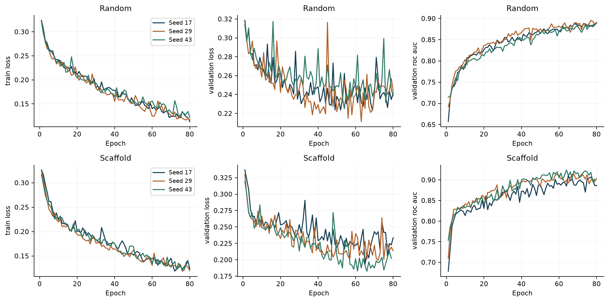
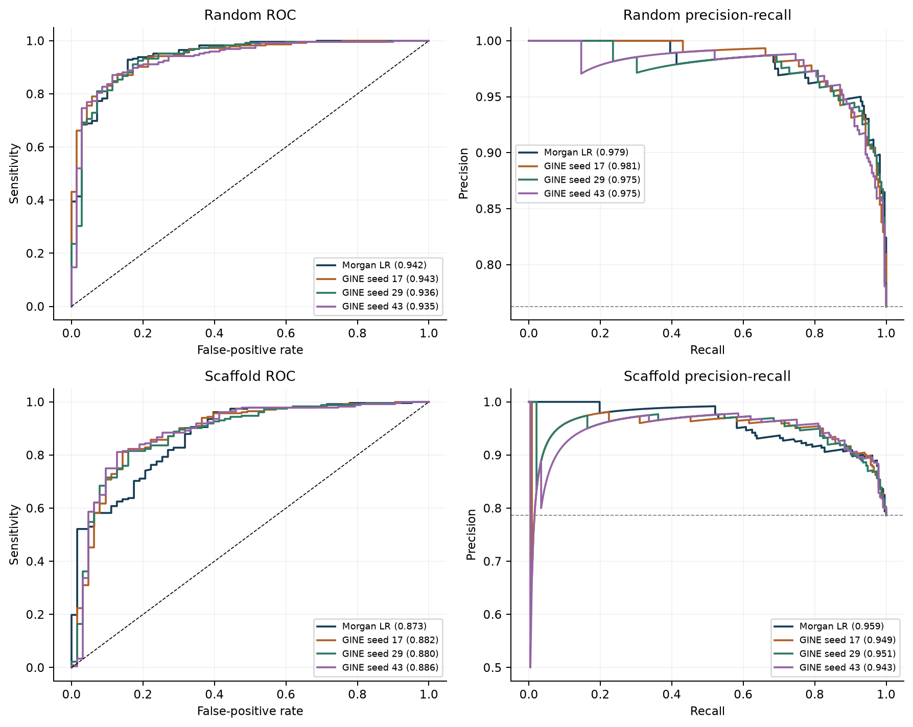
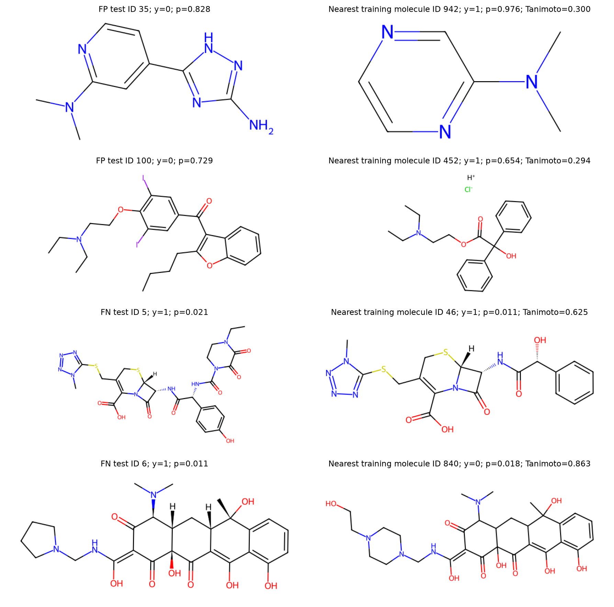

# Blood-brain barrier prediction

Morgan fingerprints and a bond-aware graph neural network predict the curated penetration label in [MoleculeNet BBBP](https://doi.org/10.1039/C7SC02664A). The experiments compare two molecular representations under stratified random and Bemis–Murcko scaffold splits, then inspect errors through similarity to training compounds.

## Questions and results

- Does a small GNN outperform a fingerprint classifier on the same molecules?
- How does evaluation change when chemical scaffolds cannot cross subset boundaries?
- Do the nearest training analogues help explain confident errors?

Cleaning starts from 2,050 raw records. Eleven invalid structures, 54 redundant consistent duplicates and all 20 records in ten conflicting-label groups are removed, leaving 1,965 unique molecules. Each evaluation uses 1,375 training, 295 validation and 295 test molecules. The scaffold split additionally keeps all identical frameworks together, including the shared empty scaffold of acyclic compounds.

| Model | Random ROC-AUC | Scaffold ROC-AUC | Random average precision | Scaffold average precision |
|---|---:|---:|---:|---:|
| Morgan logistic regression | 0.9422 | 0.8725 | 0.9793 | 0.9589 |
| GINE, three seeds | 0.9378 ± 0.0046 | 0.8827 ± 0.0027 | 0.9772 ± 0.0035 | 0.9478 ± 0.0039 |

GNN uncertainty is sample standard deviation across seeds 17, 29 and 43 on fixed partitions. This experiment shows no consistent GNN advantage. The random/scaffold contrast also changes chemical composition and prevalence; it does not isolate a causal effect or quantify performance on new experimental data.





PR-AUC is defined as average precision. All thresholds maximize validation balanced accuracy on a fixed grid; each final test evaluation uses its corresponding frozen threshold. All eight models are selected before any final test metrics are computed.



The predeclared scaffold GNN seed 17 supplies two false positives and two false negatives. Morgan Tanimoto similarity identifies each error's closest training molecule. A close analogue can share a confident error or carry a different label; similarity alone does not establish a biological explanation.

## Files and execution

- `blood_brain_barrier.ipynb`: fully executed experiment, inspection, plots and interpretation.
- `molecular_utils.py`: cleaning, splitting, categorical encoders, models, training and metrics.
- `run_experiments.py`: frozen experiment protocol and saved result artifacts.
- `run_notebook.py`: notebook execution and local HTML export.
- `test_molecular.py`: graph permutation, batching and bond-use checks.
- `outputs/`: measured tables, figures, configuration, provenance and evaluation lock.

Python 3.12 was used. From the project directory:

```sh
uv venv .venv --python 3.12
uv pip install --python .venv/bin/python -r requirements.txt
.venv/bin/python run_notebook.py
.venv/bin/python -m unittest -v test_molecular
```

The notebook downloads BBBP through `torch_geometric.datasets.MoleculeNet` on its first run. No separate CSV is required. Training uses categorical embeddings, three residual GINE layers of width 64, mean pooling, weighted binary cross-entropy and Adam. Settings are fixed in `CONFIG`; split seed is 2026. Device selection benchmarks a common training-only batch on CPU and available MPS. The recorded Apple M4 Max run selected CPU and completed the full experiment in 95 seconds, including 87 seconds of model selection.

`run_pipeline(reuse_results=True)` reuses a complete local experiment only when code, configuration and artifact hashes match. Checkpoints are excluded from Git, so a fresh clone trains all models. Set `reuse_results=False` for an explicit fresh experiment. A source or recorded-artifact change invalidates the cache. `outputs/comparison_explorer.html` is generated locally as a standalone interactive chart; `outputs/blood_brain_barrier.html` is the notebook export.

The model uses no external validation and has limited chemical coverage. Labels may be uncertain; canonical identity does not merge tautomers, salts or protonation variants. Predictions do not establish safety, efficacy, biological causality or clinical suitability. Dataset downloads, environments and checkpoints remain local. Method sources are cited in the notebook; dataset provenance is recorded in the output summary.
